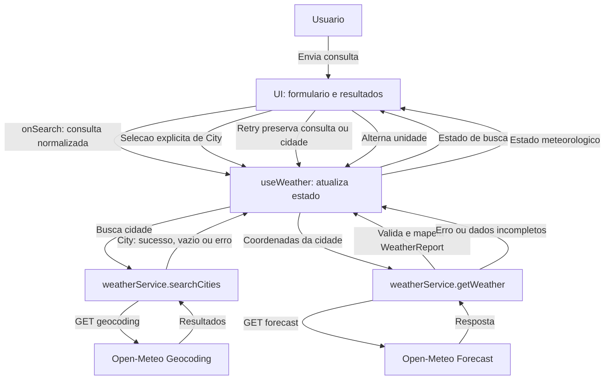

# Weather App — Plano Técnico

Este plano deriva de [`specs/weather-app-spec.md`](../specs/weather-app-spec.md). Ele define arquitetura e contratos para as histórias US-01 a US-05; não contém implementação final. Requisitos e critérios são referenciados pelos identificadores da spec (FR, AC e NFR).

## Architecture (Overview)

Aplicação de página única em React. A interface coordena busca e seleção, os serviços isolam as integrações HTTP e funções de mapeamento convertem os formatos da Open-Meteo para modelos internos validados.

```text
Usuário
  -> AppShell / SearchBar / SearchResults
       -> useWeather (estado de consulta e unidade)
           -> weatherService -> Open-Meteo Geocoding API
           -> weatherService -> Open-Meteo Forecast API
                 -> validação e mapeamento -> modelos da aplicação
       -> SearchResults / CurrentWeather / ForecastList / ForecastCard / UnitToggle
            -> estilos GeoCities compartilhados (CSS/Tailwind)
```

O formulário envia uma busca explícita; o serviço de geocodificação não seleciona um resultado por conta própria. A seleção fornece coordenadas e contexto do local ao serviço de previsão. Componentes exibem os estados que o fluxo controla, sem acessar APIs diretamente. Uma camada visual compartilhada dá o tratamento GeoCities à aplicação e aos componentes sem alterar serviços, hooks, modelos ou fluxo de dados. Esta separação atende FR-01 a FR-07, US-05 e facilita testes isolados (NFR-05, NFR-09).

## Tech Stack

| Tecnologia | Uso e justificativa |
| --- | --- |
| TypeScript strict | Contratos explícitos para modelos internos e respostas externas. |
| React 19 + Vite 8 | UI de página única e servidor/build já configurados no projeto. |
| Tailwind CSS 3 + CSS | Estilização responsiva na stack existente; CSS cobre gradientes/padrões tiled, bevel/molduras e `prefers-reduced-motion` sem bibliotecas ou imagens de terceiros (AC-12 a AC-16, NFR-09). |
| Open-Meteo Geocoding e Forecast | Busca de localidades e dados meteorológicos sem API key, conforme NFR-07. |
| Vitest + Testing Library | Testes unitários e de componentes integrados aos scripts existentes. |
| Playwright | Testes E2E do fluxo principal em 320 px e desktop, conforme AC-15. |
| Biome | Lint e formatação já configurados no projeto. |

Não é necessário estado global ou biblioteca de cache para o escopo atual. Não há servidor próprio, autenticação ou persistência remota (FR-09). Dependências instaladas e comandos disponíveis estão definidos em `package.json`.

### Direção visual

Adotar a estética kitsch/GeoCities dos anos 1990 como camada de apresentação, mantendo busca, seleção explícita, dados e estados existentes. Usar as cores aprovadas pela spec — magenta `#FF00A8`, ciano `#00E5FF`, amarelo `#FFF000`, roxo `#7B2CFF` e verde-limão `#39FF14` — com pelo menos quatro em áreas de destaque, fundos ou ornamentos em todos os estados da interface, inclusive loading, vazio e erro (AC-12). Texto informativo e controles devem permanecer legíveis; não alegar conformidade formal de contraste.

Títulos e chamadas usam serifada ou display retrô, com fallbacks locais, sem dependência de fonte externa. Pelo menos uma área usa padrão repetido/tiled ou gradiente em CSS; quando houver resultados ou previsão, mostrar divisória decorativa claramente visível e cartões/botões com bevel ou moldura marcada. Ornamentos devem ficar fora do caminho de leitura e não se parecer com controles. Não usar imagens de terceiros. Layouts fluem de 320 px a desktop, preservando textos, labels e controles sem corte ou sobreposição; foco e ordem lógica de teclado mantêm precedência sobre a decoração (AC-13 a AC-15, NFR-02, NFR-03, NFR-09). Animação decorativa é dispensável; se usada, reduzir/remover com `prefers-reduced-motion` e nunca codificar estado ou informação apenas por movimento (AC-16).

## Project Structure

Estrutura proposta para a implementação; criar somente os arquivos necessários às tarefas derivadas deste plano.

```text
src/
  components/
    AppShell.tsx             # Composição visual e regiões da página
    SearchBar.tsx           # Entrada, envio e estado de busca
    SearchResults.tsx       # Resultados selecionáveis e contexto geográfico
    CurrentWeather.tsx      # Local selecionado e condições atuais
    ForecastList.tsx        # Grade dos cinco dias
    ForecastCard.tsx        # Condições e temperaturas de um dia
    UnitToggle.tsx          # Controle acessível °C/°F
    states/
      Loading.tsx
      Error.tsx
      Empty.tsx
  hooks/
    useWeather.ts           # Orquestra estados e ações da tela
  services/
    weatherService.ts       # Geocodificação, previsão, validação e códigos WMO
  types/
    weather.ts              # Modelos internos compartilhados
  utils/
    temperature.ts          # Conversão de apresentação °C/°F
  styles/
    visual-system.css       # Tokens de cor, tipografia, ornamentos e adaptação de movimento
tests/
  unit/                     # Serviços, validação e funções puras
  components/               # Estados e interações acessíveis
  e2e/                      # Fluxos e validação visual responsiva com Playwright
```

`visual-system.css` é um ponto de organização para estilos comuns, não uma nova camada de runtime; pode permanecer junto à estrutura de estilos já existente. Os testes devem seguir a organização e configuração existentes; os diretórios são uma proposta, não exigem criar uma camada adicional se a estrutura inicial do projeto indicar uma alternativa mais simples.

## Data Model

Modelos internos sugeridos. Os nomes de campos podem ser refinados durante as tarefas, mas os contratos devem preservar os dados necessários aos critérios de aceite.

```ts
type TemperatureUnit = "celsius" | "fahrenheit";

interface City {
  id: number;
  name: string;
  country: string;
  region?: string; // mapeada de admin1 quando fornecida
  latitude: number;
  longitude: number;
  timezone?: string;
}

interface WeatherCondition {
  label: string;
  icon: string;
}

interface CurrentConditions {
  temperatureCelsius: number;
  condition: WeatherCondition;
}

interface DailyForecastDay {
  date: string; // YYYY-MM-DD no fuso local do local consultado
  condition: WeatherCondition;
  minimumCelsius: number;
  maximumCelsius: number;
}

interface WeatherReport {
  city: City;
  timezone: string;
  current: CurrentConditions;
  forecast: DailyForecastDay[];
}
```

Temperaturas ficam normalizadas em Celsius no modelo interno; Fahrenheit é derivado somente para apresentação, evitando divergência entre valores atuais e diários ao alternar unidade (FR-05, AC-07). O arredondamento exibido permanece pendente conforme a spec. O código WMO é preservado para mapear condições em português; não se presume que o texto da API esteja traduzido.

Resultados externos são tratados como dados não confiáveis: validar presença, tipos, unidades e comprimentos dos arrays antes do mapeamento. Para formar `WeatherReport`, exigir zona horária válida, campos atuais necessários e exatamente cinco datas consecutivas com condição e mínima/máxima. Não inferir o dia local usando o fuso do navegador (AC-06, AC-09, NFR-05).

## Data Flow



A UI envia a consulta ao hook; `useWeather` controla loading, sucesso, vazio e erro enquanto os serviços isolam as chamadas HTTP. Resultados de geocodificação são exibidos sem seleção automática. Após a escolha explícita, a previsão usa as coordenadas da cidade selecionada. O hook só publica um `WeatherReport` após validar os dados e os cinco dias locais; a UI apresenta temperatura, condição e estados de retry em pt-BR. A unidade altera apenas a apresentação, sem refazer a busca nem mudar local ou datas (FR-01 a FR-06, AC-01 a AC-09).

Cada nova busca deve invalidar ou cancelar a resposta anterior para que um resultado atrasado não substitua a consulta mais recente. Uma mudança de unidade durante carregamento mantém a preferência atual e aplica-a aos dados quando a resposta válida chegar.

## External APIs

### Geocoding

- Endpoint: `https://geocoding-api.open-meteo.com/v1/search`
- Parâmetros: `name` (consulta normalizada), `count` (limite configurável), `language=pt` e `format=json`.
- Campos usados: `id`, `name`, `country`, `admin1` quando presente (mapeado para `region`), `latitude`, `longitude` e `timezone` quando presente.
- Uma lista ausente ou vazia equivale a nenhum resultado. Região e zona horária ausentes não devem impedir a escolha da cidade; porém, zona horária ausente impede calcular datas locais com segurança e deve ser tratada no carregamento da previsão.

### Forecast

- Endpoint: `https://api.open-meteo.com/v1/forecast`
- Parâmetros: `latitude`, `longitude`, `current=temperature_2m,weather_code`, `daily=weather_code,temperature_2m_max,temperature_2m_min`, `temperature_unit=celsius`, `timezone=auto` e `forecast_days=5`.
- Campos usados: temperatura e código meteorológico atuais; arrays diários `time`, `weather_code`, `temperature_2m_min` e `temperature_2m_max`, além de `timezone` e metadados de unidade para validação.
- Conferir a resposta real do provedor durante a implementação. Se `forecast_days=5` não garantir a data local atual no contexto de uma chamada específica, ajustar a solicitação com base no contrato documentado da API; o critério invariável é hoje e os quatro dias seguintes no fuso do local.
- Traduzir `weather_code` por tabela baseada nos códigos WMO documentados. Código desconhecido deve resultar em rótulo genérico em pt-BR, não em falha de renderização.

Usar timeout de 10 segundos para toda a operação de rede, incluindo a leitura do JSON. Informar o limite e orientar a pessoa a verificar a conexão; falhas de rede devem distinguir-se de erros HTTP e de respostas inválidas. A implementação deve confirmar limites de uso e obrigações de atribuição vigentes antes da publicação (NFR-07 e risco da spec). Nenhuma chave secreta é necessária.

## State Management

O estado de consulta vive no hook `useWeather`; a unidade fica na página e não deve ser duplicada no hook. Não introduzir store global. O hook mantém texto da busca, cidades retornadas, relatório meteorológico, erro e status (`idle`, `loading`, `success`, `empty` ou `error`). Durante `loading`, um campo de operação distingue busca de previsão; o hook guarda a última operação para retry. A busca apresenta resultados para seleção explícita; não seleciona automaticamente a primeira cidade (FR-02, AC-02).

Uma busca bem-sucedida pode ter `cities` sem relatório `data`; selecionar uma cidade consulta pelas coordenadas. Falha de busca ou previsão não apaga silenciosamente um relatório anterior. Dados incompletos continuam sendo erro, nunca sucesso.

A unidade permanece em memória durante a sessão/navegação atual; não persistir no servidor nem em armazenamento local até a decisão em aberto ser tomada. A troca de unidade afeta apenas a formatação, sem alterar os dados normalizados ou disparar novas requisições.

## Error Handling

| Situação | Comportamento |
| --- | --- |
| Busca vazia | Não fazer requisição; manter a interface pronta para edição (AC-01). |
| Busca sem correspondências | Mostrar mensagem em pt-BR e permitir nova busca (AC-03). |
| Rede, timeout, HTTP ou limite na geocodificação | Mostrar erro de busca distinguível do estado vazio; ação de tentar novamente preserva o texto (FR-06, AC-08). |
| Falha HTTP/rede ou limite no forecast | Manter cidade selecionada, não exibir previsão incompleta como válida e oferecer nova tentativa sem nova busca (AC-08). |
| Resposta inválida, fuso ausente, dia faltante ou arrays inconsistentes | Rejeitar o relatório completo, apresentar erro recuperável e registrar detalhe técnico apenas para diagnóstico; não expor stack trace na UI (NFR-05). |
| Código meteorológico sem mapeamento | Exibir rótulo genérico em pt-BR e manter temperaturas válidas. |
| Resposta de consulta anterior chega após uma nova | Cancelar com `AbortController` quando possível ou ignorar por identificador de requisição. |

Mensagens visíveis devem ser pt-BR, com rótulos e anúncios acessíveis. Erro de busca não deve apagar a cidade/relatório anterior sem uma decisão explícita de produto; comportamento de manter dados anteriores durante uma nova seleção precisa ser definido nas tarefas de UI. Retry reutiliza os parâmetros da operação original.

## Testing Strategy

- **Unitários (Vitest):** normalização de consulta; mapeamento de geocoding; validação e mapeamento das respostas; códigos WMO conhecidos e desconhecidos; conversão Celsius/Fahrenheit; datas e sequência dos cinco dias usando valores do provedor/fuso, sem depender do fuso da máquina. Cobrir respostas incompletas e inválidas (AC-01, AC-06, AC-07, AC-09; NFR-05).
- **Serviços:** mockar `fetch` para sucesso, lista vazia, erro HTTP, falha de rede, timeout, JSON inválido e resposta com dias faltantes; verificar parâmetros e que resultados são validados antes de chegar à UI (FR-01 a FR-04, FR-06).
- **Componentes (Testing Library):** estados loading/empty/error/success; seleção explícita por teclado e ponteiro; rótulos, foco visível e mensagens acessíveis; retry preservando a consulta/local; alternância de unidade sem alterar cidade ou datas (AC-02, AC-03, AC-07, AC-08, AC-10).
- **E2E (Playwright):** fluxo de busca, seleção, visualização de clima/previsão, alternância de unidade e caminho de erro/retry com respostas de rede controladas. Executar em 320 px e desktop: verificar conteúdo essencial sem corte/sobreposição, legibilidade, labels, identificabilidade dos controles, foco visível e ordem de teclado lógica. Incluir a preferência `prefers-reduced-motion` e confirmar que animação decorativa não comunica estado (US-01 a US-05, AC-10, AC-12 a AC-16, NFR-02, NFR-03, NFR-09).
- **Revisão visual:** inspecionar telas carregadas nos estados relevantes para confirmar presença de pelo menos quatro cores aprovadas, tipografia retrô, padrão tiled/gradiente, divisória decorativa e bevel/moldura sem interferência de uso. Revisar capturas em 320 px e desktop; não depender exclusivamente de teste por pixels (AC-12 a AC-15).
- **Comandos do projeto:** `pnpm test`, `pnpm lint` e `pnpm build`; `pnpm test:e2e` para os cenários E2E. As metas de desempenho e de acessibilidade mensurável ficam pendentes até definição dos critérios na spec.

## Risks & Trade-offs

| Risco ou decisão | Trade-off e resposta técnica |
| --- | --- |
| Cidades homônimas | Busca retorna opções em vez de selecionar automaticamente; mostrar país e região disponível e consultar pelas coordenadas do item selecionado (AC-02, AC-04). |
| Previsão parcial ou inconsistente | Validação estrita pode negar alguns resultados do provedor, mas evita apresentar menos de cinco dias como previsão completa (AC-08, NFR-05). |
| Fuso horário e mudança de data perto da meia-noite | Usar timezone retornado pelo forecast e suas datas locais; não depender do fuso do dispositivo. Resposta sem fuso não sustenta a garantia de datas locais (AC-06, AC-09). |
| Conversão de temperatura no cliente | Manter Celsius como forma canônica simplifica troca imediata de unidade e evita nova requisição; arredondamento ainda precisa ser decidido. |
| Respostas atrasadas concorrentes | Cancelamento ou descarte por identificador reduz risco de uma consulta antiga sobrescrever a atual, com pequena complexidade no hook. |
| Dependência externa sem API key | Simplifica configuração, mas disponibilidade, limites e termos são externos; tratar falhas, definir timeout e confirmar atribuição/uso antes do lançamento (NFR-07). |
| Países e cobertura não definidos | Não presumir compatibilidade universal dos dados. Aprovar países suportados e cobertura antes de fechar critérios de produção; a validação visual deve cobrir 320 px e desktop conforme AC-15 (NFR-02 e perguntas em aberto da spec). |
| Estado apenas em memória | Evita persistência não solicitada e mantém escopo simples; unidade volta a Celsius ao reiniciar a sessão. Persistência local continua uma decisão em aberto (FR-09, NFR-08). |
| Atualização e desempenho sem metas | O timeout operacional de rede está definido em 10 segundos; cache, atualização automática e SLO continuam sem definição, conforme NFR-06 e perguntas em aberto da spec. |
| Acessibilidade sem padrão/meta aprovados | Teclado, semântica, rótulos e foco visível são requisitos desde a implementação; conformidade formal e metas de contraste precisam ser decididas (NFR-03). |
| Estética carregada prejudica leitura ou uso móvel | Limitar ornamentos ao tratamento visual; verificar legibilidade, controles e fluxo de teclado em 320 px e desktop. A direção exige cores fortes, mas não sobrepõe conteúdo, foco ou responsividade (US-05, AC-12 a AC-16, NFR-09). |
| Dependência de animação ou recurso externo | Preferir decoração estática CSS e fontes locais; se houver movimento, respeitar `prefers-reduced-motion`. Sem imagens de terceiros e sem nova dependência (AC-13, AC-16, NFR-09). |